# Retail Shelf Occupancy Analytics — Power BI

A ten-page Power BI report that measures how much retail shelf space a national home-textiles
brand holds against its competitors and against unbranded stock, across zones, regions, areas,
cities and individual stores.

Built as a **Power BI developer / data analyst** engagement: DirectQuery against an
Azure-hosted SQL Server, a fifteen-table model, and a navigation-driven report designed for
sales leadership rather than for analysts.

**Headline result:** across the observed period, unbranded product occupied **68.38%** of
measured shelf space, competitor brands **22.40%**, and the client brand **9.22%** — a
visibility gap that the report then localises down to individual stores.

---

## Contents

| Section | What it covers |
|---|---|
| [The business problem](#the-business-problem) | Why the report exists and what decision it supports |
| [Data architecture](#data-architecture) | JSON → Azure SQL → DirectQuery → Power BI |
| [Data model](#data-model) | 15 tables, three logical groups, 12 used by visuals |
| [Report structure](#report-structure) | How the ten pages are organised |
| [The charts, explained](#the-charts-explained) | Each visual: what it shows, how it is built, what it told the client |
| [Power BI techniques used](#power-bi-techniques-used) | Synced slicers, drill-through, bookmarks, navigation |
| [Deployment](#deployment) | Publishing and access control |
| [Limitations](LIMITATIONS.md) | Honest constraints of the build |
| [Roadmap](docs/05-roadmap.md) | What the next iteration fixes |

Deeper documentation lives in [`docs/`](docs/).

---

## The business problem

A home-textiles manufacturer sells through thousands of third-party retail outlets it does not
own. In those stores its products compete for shelf space against rival brands and against
unbranded stock, and head office had **no measurement of how much shelf it was actually
winning**.

The question the business needed answered was narrow and operational:

> *In any given region, area, city or store — what share of visible shelf is ours, what share is
> the competition's, and where is the gap worst?*

Answering it converts a pile of store-visit photographs into a ranked list of stores where a
field visit would pay for itself. That is the report's purpose: not to describe the market, but
to tell a regional sales manager which doors to walk into next.

### What the report had to support

* Compare three mutually exclusive categories — **client brand**, **competitor brands**,
  **unbranded** — on a consistent percentage basis.
* Work at five levels of geography (zone → region → area → pincode → store) without forcing the
  user to rebuild filters at each level.
* Let a national head start at a summary and reach a single store's detail in a few clicks.
* Stay current against a database the client's own systems were writing to.

---

## Data architecture

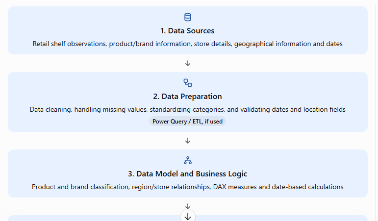
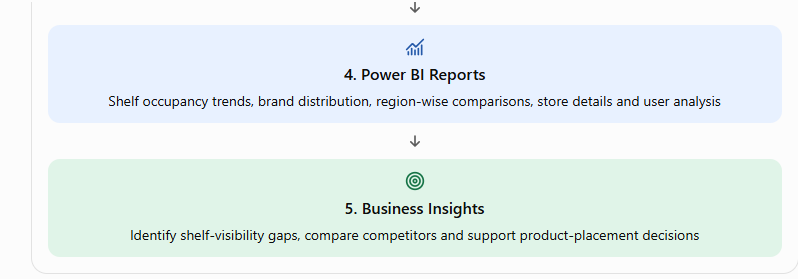

The pipeline runs in five stages: data sources → data preparation → data model and business
logic → Power BI reports → business insights.

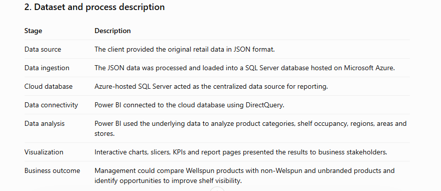

The client supplied raw retail observations as **JSON**. That JSON was processed into a **SQL
Server database hosted on Microsoft Azure**, which became the single reporting source. Power BI
connected to it over **DirectQuery**, so the report reflects the database's current state rather
than a cached snapshot.

**Why DirectQuery and not Import:** the client's operational systems continued writing
store-visit records after the report shipped. An imported model would have needed a refresh
schedule and would have served stale numbers between refreshes. DirectQuery trades some query
responsiveness for currency — the right trade when field teams are checking yesterday's visits.
The cost of that choice is documented in [LIMITATIONS.md](LIMITATIONS.md).

Transformation and cleaning were done in **Power Query**: correcting data types, handling missing
values, standardising category labels, and validating date and location fields before they
reached the model.

Full detail: [View Full Data Architecture](docs/01-data-architecture.md)

---

## Data model

Fifteen tables, falling into three logical groups:

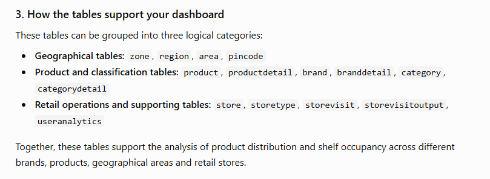

| Group | Tables |
|---|---|
| **Geography** | `zone`, `region`, `area`, `pincode` |
| **Product & classification** | `product`, `productdetail`, `brand`, `branddetail`, `category`, `categorydetail` |
| **Retail operations & supporting** | `store`, `storetype`, `storevisit`, `storevisitoutput`, `useranalytics` |

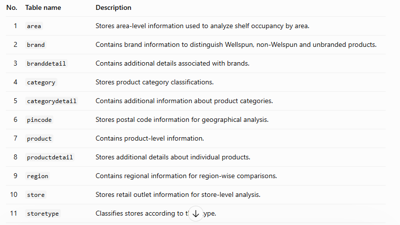
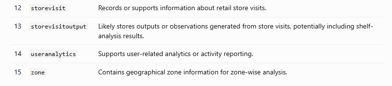

`storevisit` is the central fact: it carries the visit date (`created_at`) that drives every
trend chart, and it hosts the brand-comparison measures. `storevisitoutput` holds the per-visit
shelf counts, including the `Unbranded` column. The geography and product tables act as
dimensions, filtering the facts through the relationships defined in the model.

Twelve of the fifteen tables are referenced directly by report visuals; the remaining three
(`productdetail`, `categorydetail`, `programdetail`) support the model without appearing on a
canvas.

Full detail, including the field-by-field usage inventory:
[`docs/02-data-model.md`](docs/02-data-model.md)

---

## Report structure

Ten pages, organised as three overview pages followed by six detail pages and one operational
page:

| # | Page | Role |
|---|---|---|
| 1 | **Region Wise** | Landing page — geography overview |
| 2 | **Product Wise** | Brand, category and programme breakdown |
| 3 | **Store Wise** | Store and city overview |
| 4 | **Region Details** | Client brand, drilled to pincode |
| 5 | **Store Details** | Client brand, drilled to store |
| 6 | **Non-Welspun Region Details** | Competitors, drilled to pincode |
| 7 | **Non-Welspun Store & Brand Details** | Competitors, by store and brand |
| 8 | **Unbranded Region Details** | Unbranded stock, by geography |
| 9 | **Unbranded Store Details** | Unbranded stock, by store |
| 10 | **User Analysis** | Field-staff data-capture coverage |

The three-by-three symmetry is deliberate: each of the three product categories gets a region
page and a store page built to the same layout, so a user who learns one page can read all six.

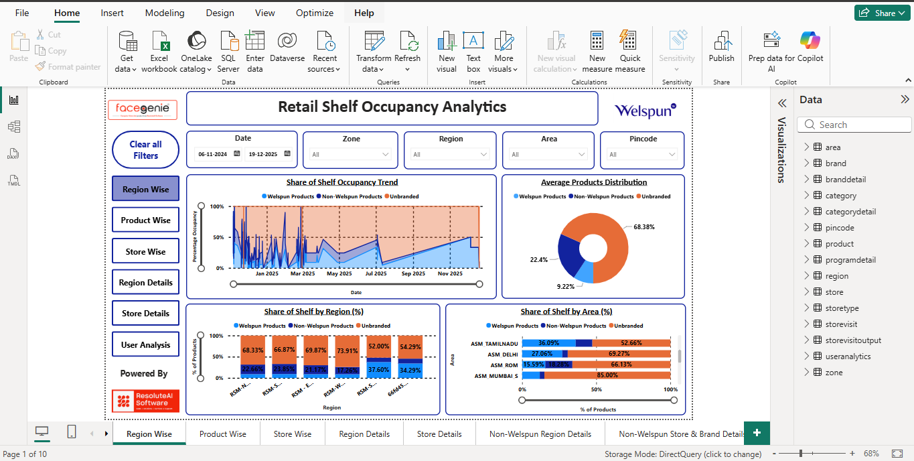

The landing page in Power BI Desktop. Note the left-hand page navigator, the four synced slicers
across the top (Date, Zone, Region, Area, Pincode), and the **Clear all Filters** button —
the three pieces of furniture repeated on every page.

Page-by-page walkthrough: [`docs/03-report-pages.md`](docs/03-report-pages.md)

---

## The charts, explained

### 1. Share of Shelf Occupancy Trend

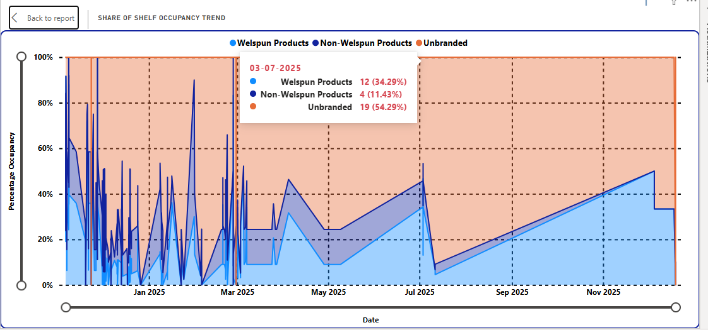

**Visual type:** 100% stacked area chart
**Axis:** `storevisit[created_at]`, formatted `dd/MM/yyyy`, sorted ascending
**Values:** `[Welspun Products]`, `[Non-Welspun Products]`, `Sum(storevisitoutput[Unbranded])`

The chart normalises every date to 100%, so it answers *share*, not *volume* — the right framing
when the number of store visits varies day to day. A raw count chart would have made a busy
survey week look like a win.

Tooltips carry the underlying counts alongside the percentage, which is what makes the chart
safe to read. The screenshot has the tooltip open on **3 July 2025**:

| Category | Share | Count |
|---|---|---|
| Client brand | 34.29% | 12 |
| Competitor brands | 11.43% | 4 |
| Unbranded | 54.29% | 19 |
| **Total** | **100%** | **35** |

Read without the tooltip, that day looks like a standout result — 34.29% against a 9.22% average.
Read with it, it is **35 products in a handful of stores**. The counts are what stop a single
good day being reported upward as a trend.

**What the shape shows:** the left third of the series is violently spiky, then the line settles
from roughly May 2025 onward. That is not a change in shelf behaviour — it is a change in
*sampling density*. Early in the programme, a day might contain one or two store visits, so a
single shelf swung the daily percentage from 0% to 100%. The date slider at the bottom exists
precisely so a user can exclude that thin early period and read the stable window.

> **Analyst's note:** the spiky region is a data-density artefact, not a trend. A future
> iteration should suppress days below a minimum visit count rather than relying on the user to
> move the slider.

---

### 2. Average Products Distribution

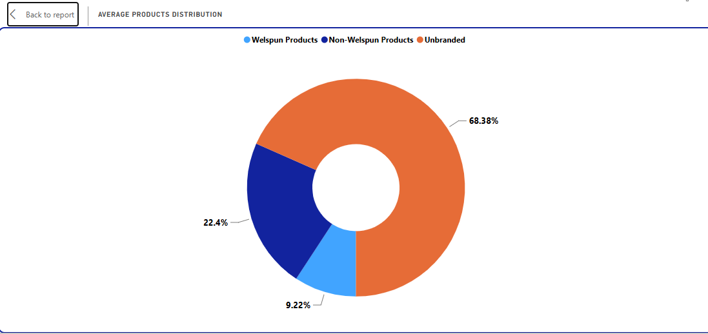

**Visual type:** donut chart
**Values:** the same three measures as the trend chart, aggregated across the filter context

The report's single most important number, and the reason the engagement existed:

| Category | Share |
|---|---|
| Unbranded | **68.38%** |
| Competitor brands | **22.40%** |
| Client brand | **9.22%** |

Read commercially: roughly **seven in ten** products on the measured shelves carry no brand at
all. The client's competition is not primarily other manufacturers — it is the unbranded segment.
That reframes the shelf strategy from *win share from rivals* to *convert unbranded facings*,
which is a different and larger commercial opportunity.

It also sets the realistic ceiling. Against competitors alone the client holds 9.22 / 31.62 ≈
**29%** of branded shelf. The headline 9.22% understates the brand's standing in the segment it
actually competes in — which is why the next chart matters.

---

### 3. Distribution summary

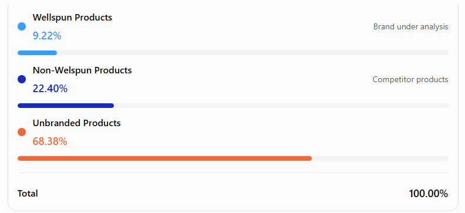

A plain summary card restating the three shares with their business meaning labelled — *brand
under analysis*, *competitor products* — and a total that proves the three categories are
mutually exclusive and exhaustive (100.00%).

Trivial-looking, and deliberately so. In a report read by national and regional heads, a card
that states the headline in words removes any chance of a donut segment being misread.

---

### 4. Client Brand Distribution

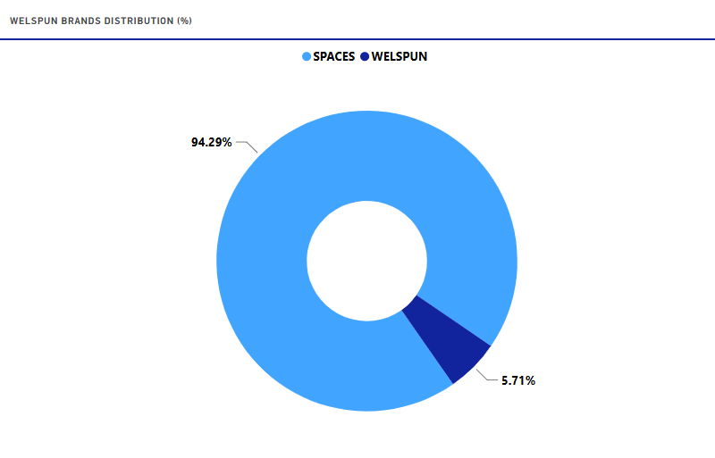

**Visual type:** donut chart
**Category:** `brand[name]` **Values:** `[Welspun Products]`

The `[Welspun Products]` measure covers two brands in the client's portfolio. Within the client's
own shelf presence, they split:

| Brand | Share of client shelf |
|---|---|
| SPACES | **94.29%** |
| WELSPUN | **5.71%** |

These two together form the client's half of the branded section of the market — the segment the
business is trying to grow visibility in.

This is the chart that reframes the headline. The client's shelf footprint is almost entirely
SPACES; the WELSPUN-branded line is barely present on the measured shelves. So the 9.22% total is
not one brand underperforming across the board — it is one brand carrying the portfolio while the
other is effectively absent. Those two findings imply completely different interventions
(defend and extend SPACES vs. establish WELSPUN at all), and the report separates them.

---

### 5. Share of Shelf by Store City

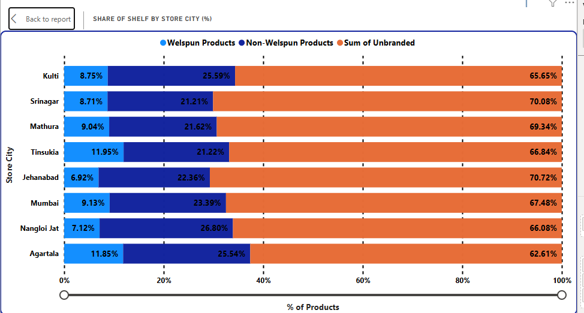

**Visual type:** 100% stacked bar chart
**Category:** `store[city]` **Values:** the three category measures

Where the analysis becomes actionable. Unbranded stock dominates every city in a tight band —
**62.61% to 70.72%** — which tells the client the unbranded problem is structural and national,
not a local failure anyone can be held accountable for.

The client's own share varies far more:

| | City | Client share |
|---|---|---|
| Strongest | Tinsukia | **11.95%** |
| | Agartala | 11.85% |
| Weakest | Jehanabad | **6.92%** |

The spread between best and worst city is **5.03 percentage points** — a 1.7× difference. That
is the gap a regional manager can be tasked with closing.

The competitor column carries a second signal: **Nangloi Jat shows the highest competitor share
at 26.80%**, and it is also near the bottom for client share at 7.12%. A city where rivals are
strong *and* the client is weak is a different problem from a city where unbranded simply
dominates, and it warrants a different response.

**Why 100% stacked rather than clustered:** with three categories across eight cities, a
clustered bar chart would have produced 24 bars and made the cross-city comparison a counting
exercise. Normalising to 100% puts every city on the same baseline so the eye compares the one
thing that matters — the width of the leftmost segment.

---

### 6. Image Percentage by User Type

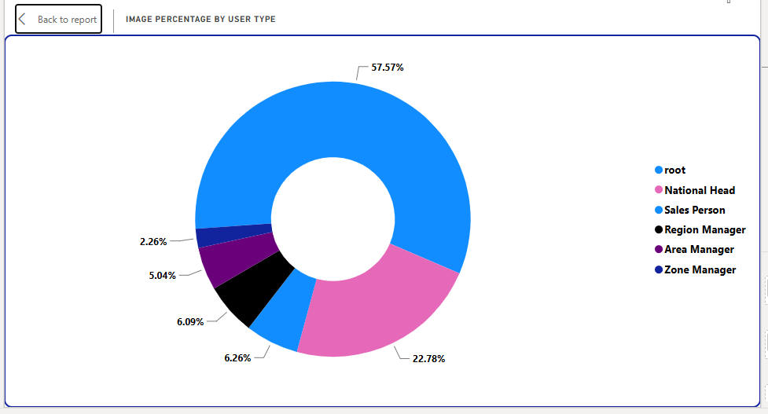

**Visual type:** donut chart
**Category:** `useranalytics[usertype]` **Values:** `useranalytics[imagecount]`

This page measures the *data collection*, not the shelves — and it is the page that makes the
rest of the report trustworthy.

| User type | Share of images |
|---|---|
| Sales Person | **57.57%** |
| National Head | 22.78% |
| `root` | 6.26% |
| Region Manager | 6.09% |
| Area Manager | 5.04% |
| Zone Manager | 2.26% |

Two findings worth stating plainly.

**First:** the distribution is inverted against what you would expect. Sales people capture the
majority, which is correct — but **National Head is the second-largest contributor at 22.78%**,
ahead of every regional and area role. A national executive personally generating nearly a
quarter of all field images suggests either a shared or default account, or genuinely patchy
middle-tier adoption. Either way it is a question for the client, and the report surfaces it
rather than hiding it.

**Second:** `root` accounts for **6.26%** of all images. That is an administrative or system
account, not a field role. One image in sixteen entered the dataset through a channel that has no
owner in the field hierarchy — a data-governance point the business should resolve before
treating store-level counts as complete.

A report that quietly dropped the `root` bucket would have looked cleaner and been less honest.

---

## Power BI techniques used

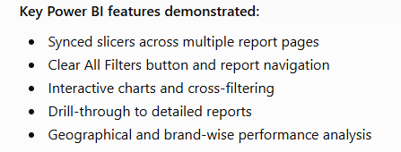

* **Synced slicers** — Date, Zone, Region, Area and Pincode stay in step across every page, so a
  filter set once survives navigation. This is the single decision that makes a ten-page report
  usable rather than exhausting.
* **Drill-through** — from any overview page to the matching detail page, carrying the selected
  context.
* **Page navigation** — a persistent left-hand navigator plus *Back to report* buttons on the
  detail pages, giving a predictable route in and out.
* **Clear all Filters** — a single action button that resets slicer state, placed identically on
  every page.
* **Bookmarks** — seven bookmarks supporting the navigation and view-switching behaviour.
* **Cross-filtering** — selecting a region in one visual filters every other visual on the page.
* **Tooltips carrying absolute counts** — every percentage visual exposes the underlying count on
  hover, so no share is ever read without its denominator.

---

## Measures

Three explicit measures carry the brand comparison, aggregating `programdetail[count]` and
classifying on `brand[is_welspun]`:

```dax
Welspun Products =
CALCULATE( SUM( programdetail[count] ), brand[is_welspun] = TRUE() )

Non-Welspun Products =
SUM( programdetail[count] ) - [Welspun Products]
```

The classification lives on the `brand` dimension as a boolean flag rather than being hard-coded
as a list of brand names — so adding a brand to the portfolio is a one-row change in the
dimension table, not a measure rewrite. Both filters fold to SQL `WHERE` clauses, which matters
under DirectQuery where every evaluation is a round trip.

The unbranded series is not a measure: it is an implicit `Sum(storevisitoutput[Unbranded])`,
sourced from a different table.

> **Open item:** `[Non-Welspun Products]` is written as a residual — *everything not flagged as
> the client's* — rather than as an explicit competitor definition. A reconciliation check and
> the recommended rewrite are in [`docs/04-measures.md`](docs/04-measures.md).

Full documentation: [`docs/04-measures.md`](docs/04-measures.md) ·
[`dax/measures.dax`](dax/measures.dax)

---

## Deployment

The report was published to the **Power BI Service** and deployed to a designated workspace with
permissions configured at both the report and semantic-model level. Access was restricted to
authorised users — viewing the report required the appropriate permission on the underlying
dataset as well as on the report itself.

---

## Repository structure

```
Retail-Shelf-Occupancy-Analytics/
├── README.md                          # this file
├── LIMITATIONS.md                     # honest constraints of the build
├── Retail-Shelf-Occupancy-Analytics.pbix
├── dax/                               # measure expressions (pending)
├── docs/
│   ├── 01-data-architecture.md
│   ├── 02-data-model.md
│   ├── 03-report-pages.md
│   ├── 04-measures.md
│   └── 05-roadmap.md
├── architecture/                      # pipeline and process screenshots
├── model/                             # data-model screenshots
└── report/                            # report canvas and chart screenshots
```

---

## Skills demonstrated

**Power BI** — DirectQuery modelling, Power Query (ETL), DAX measures, 100% stacked area / bar /
column charts, donut and pie charts, matrix and table visuals, synced slicers, drill-through,
bookmarks, page navigation, custom tooltips, Power BI Service deployment and access control.

**Data analysis** — share-of-shelf methodology, categorical comparison on a normalised basis,
geographic segmentation across five levels, data-quality assessment of a field-collected dataset,
translating distribution metrics into prioritised commercial recommendations.

**Stakeholder-facing design** — a ten-page report built for sales leadership, where navigation
consistency and the visibility of denominators mattered more than analytical density.

---

## Author

**Ayushi Shori** — Data Analyst, Noida, India

* LinkedIn: www.linkedin.com/in/ayushishori
* Email: shoriashi7@gmail.com
